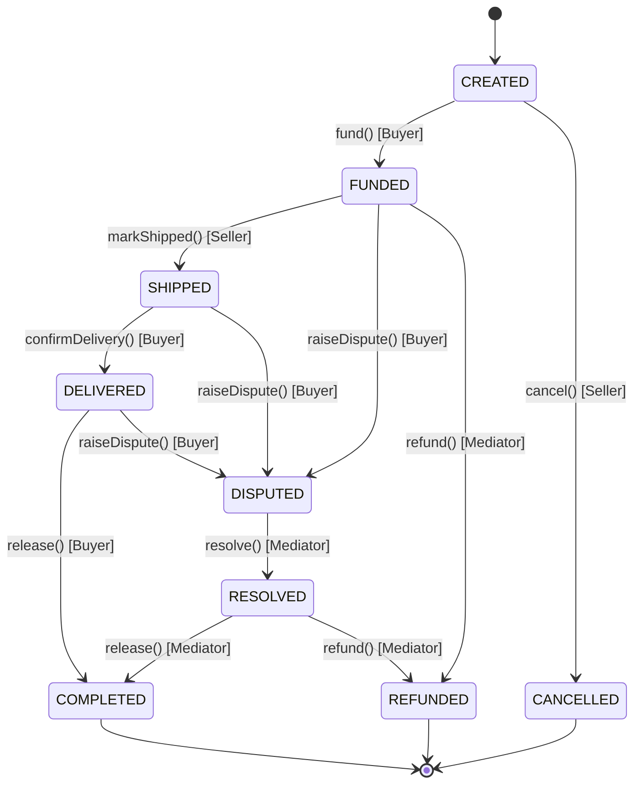

# Escrow Trade Lifecycle

This document describes the trade status state machine used by the escrow flow: every state a trade can be in, the valid transitions between states, which counterparty may trigger each transition, and where the logic lives in the smart contracts and frontend.

## States

| State | Description |
| --- | --- |
| `CREATED` | Trade has been created by the seller but not yet funded. |
| `FUNDED` | Buyer has deposited the escrow amount into the contract. |
| `SHIPPED` | Seller has marked the goods as shipped. |
| `DELIVERED` | Buyer has confirmed receipt of the goods. |
| `DISPUTED` | A counterparty has raised a dispute; a mediator is now involved. |
| `RESOLVED` | Mediator has resolved a dispute, assigning funds to one party. |
| `COMPLETED` | Trade finished successfully; funds released to the seller. |
| `CANCELLED` | Trade was cancelled before funding or by mutual agreement. |
| `REFUNDED` | Funds returned to the buyer (post-dispute or cancellation after funding). |

## State Diagram

## Permissions by State

| State | Buyer | Seller | Mediator |
| --- | --- | --- | --- |
| `CREATED` | `fund()` | `cancel()` | — |
| `FUNDED` | `raiseDispute()` | `markShipped()` | `refund()` |
| `SHIPPED` | `confirmDelivery()`, `raiseDispute()` | — | — |
| `DELIVERED` | `release()`, `raiseDispute()` | — | — |
| `DISPUTED` | — | — | `resolve()` |
| `RESOLVED` | — | — | `release()`, `refund()` |
| `COMPLETED` | — | — | — |
| `CANCELLED` | — | — | — |
| `REFUNDED` | — | — | — |

## Smart Contract Methods

Each transition maps to a method on the escrow contract:

- `fund()` — Buyer deposits the escrow amount (`CREATED → FUNDED`).
- `cancel()` — Seller cancels an unfunded trade (`CREATED → CANCELLED`).
- `markShipped()` — Seller marks goods shipped (`FUNDED → SHIPPED`).
- `confirmDelivery()` — Buyer confirms receipt (`SHIPPED → DELIVERED`).
- `release()` — Buyer (or Mediator after resolution) releases funds to the seller (`DELIVERED → COMPLETED`, `RESOLVED → COMPLETED`).
- `raiseDispute()` — Buyer opens a dispute (`FUNDED/SHIPPED/DELIVERED → DISPUTED`).
- `resolve()` — Mediator resolves a dispute (`DISPUTED → RESOLVED`).
- `refund()` — Mediator returns funds to the buyer (`FUNDED → REFUNDED`, `RESOLVED → REFUNDED`).

## Frontend Components

- `frontend/src/lib/trade/nextAction.ts` — computes the next permissible action(s) for the current user based on trade status and role. This is the single source of truth for which buttons/actions the UI exposes per state.
- Trade detail views consume `nextAction.ts` to render the correct action buttons for Buyer, Seller, and Mediator.

## Related Documentation

- See [`docs/glossary.md`](./glossary.md) for terminology used throughout this document.
